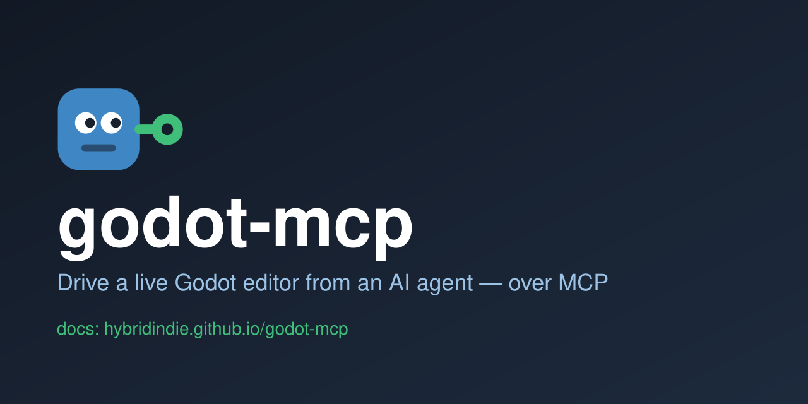

<p align="center">
  <a href="https://hybridindie.github.io/godot-mcp/">
    
  </a>
</p>

<h1 align="center">Godot Editor MCP</h1>

<p align="center">
  A <strong>generic, game-agnostic</strong> <a href="https://modelcontextprotocol.io">Model Context Protocol</a> (MCP) server for <strong>AI-driven Godot development</strong>.
</p>

<p align="center">
  <a href="https://pypi.org/project/godot-editor-mcp/"></a>
  <a href="https://github.com/hybridindie/godot-mcp/pkgs/container/godot-mcp"></a>
  <a href="https://hybridindie.github.io/godot-mcp/"></a>
  <a href="https://github.com/hybridindie/godot-mcp/releases"></a>
  <a href="https://github.com/hybridindie/godot-mcp/releases/tag/2026.10.20.1"></a>
  <a href="LICENSE"></a>
</p>

> **Make a game?** Let your AI assistant install and drive it — **[For creators](https://hybridindie.github.io/godot-mcp/for-creators.html)**.
> **Building on it?** Start with the **[developer track](https://hybridindie.github.io/godot-mcp/for-developers.html)** for the contract, architecture, and extension points.
>
> The full manual is [hybridindie.github.io/godot-mcp](https://hybridindie.github.io/godot-mcp/); this README is the front door. For LLM agents: [`llms.txt`](https://hybridindie.github.io/godot-mcp/llms.txt) (page index) · [`llms-full.txt`](https://hybridindie.github.io/godot-mcp/llms-full.txt) (the whole site as one markdown document).

> **Status:** feature-complete. **208 tools** across **29 categories** — always-on `core` plus 28 toggleable toolsets, of which only `inspection` is enabled by default (the rest are gated off until the agent asks).
>
> **Two channels:** **stable `2026.10.20.1`** (Godot 4.4–4.7, validated on 4.7) and **beta `2026.11.04b2`**, verified against **Godot 4.8-beta2** and adding the 4.8-only surface (engine support reporting, scene metadata, physics read-back, VisualShader groups). The floor stays Godot 4.4. Development mirrors the channels: **`main` is the beta line**, **`stable` is the stable line** (see [CONTRIBUTING](CONTRIBUTING.md#branches-and-release-channels)). `godot-editor-mcp` on [PyPI](https://pypi.org/project/godot-editor-mcp/) · `ghcr.io/hybridindie/godot-mcp`.

> **One name, three identifiers.** **Godot Editor MCP** is the product: it drives the
> **editor** as its surface, through the addon. The repository and MCP server ID stay
> `godot-mcp` for wire compatibility; the package/CLI is `godot-editor-mcp`; the in-editor
> plugin is **Godot Editor MCP - Addon**; and every tool shares the `godot_` prefix.

---

## What it is

Godot Editor MCP bridges an AI agent and a **live** Godot editor. Instead of editing files blindly on disk, the agent drives the editor directly over MCP:

- **Inspect** the scene tree, selected nodes, and project settings live
- **Mutate** scenes — nodes, scripts, signals — with undo
- **Edit** GDScript and check it for parse errors
- **Run** the game headless or control a live play session
- **Simulate** input, record replays, screenshot, and profile performance
- **Export** builds, analyze code statically, and refactor across scenes

It is **game-agnostic** — it knows Godot, not your game. A tower-defense roguelite, a 3D platformer, and a visual novel use the same generic tools; game-specific vocabulary belongs in a separate consumer project.

```
AI client ──stdio / HTTP──▶ FastMCP server ──WebSocket──▶ Godot addon ──▶ live editor
```

<!-- TODO(demo): record the flagship demo and embed the 10–15s GIF here, above
     the fold. Brief: 20+ nodes across 2–3 scenes, Ctrl+Z back to the exact
     baseline, and the transcript showing `undoable: true` *before* the undo.
     Do not add an  tag until the asset exists. -->

## Why build on this

Godot Editor MCP is meant to be the base you build a game's AI vocabulary on, not
one more self-contained assistant. Seven things follow from that:

- **Editor-first, not file-first.** Scene and project mutations go through the
  editor's own APIs, so agent edits join your undo stack (Ctrl+Z) and the editor's
  save rules apply — not blind file rewrites behind its back. See
  [why & how it works](https://hybridindie.github.io/godot-mcp/concepts.html).
- **Safety is enforced on the server.** `dry_run` previews, `confirm` gates, and
  preconditions live in the server, not the addon — a misbehaving editor plugin
  cannot bypass them. See [safety classes](https://hybridindie.github.io/godot-mcp/reference-safety-classes.html).
- **A versioned compatibility contract.** Tool names, params, result shapes, and a
  `contract_version` that additive changes never bump — contract-tested, so an
  integration does not break silently. See [the contract](https://hybridindie.github.io/godot-mcp/reference-contract.html).
- **Ground truth on every mutation.** Results report `persisted`, `undoable`,
  `aborted_at`, and `rescan_pending`, so a client can tell "looks done" from "is
  done" without re-reading the scene. See [persistence truth](https://hybridindie.github.io/godot-mcp/architecture/persistence.html).
- **A local extension point.** Annotate a typed GDScript function with `## @mcp_tool`
  and it becomes a first-class, safety-classed `godot_project_*` tool that runs
  entirely in your editor — no cloud, no fork. See [project-defined tools](https://hybridindie.github.io/godot-mcp/guides-project-tools.html).
- **Skills ship with the server.** Three installable skills, including `godot-expert`
  (the Godot 4.x rules most people learn by hitting the bug). See [skills](https://hybridindie.github.io/godot-mcp/reference-skills.html).
- **No telemetry, no cloud, no client lock-in.** MIT, self-hostable, standard MCP —
  any client, plain config.

Honest comparison against four other live-editor Godot MCP servers (including where
this one is *not* ahead): **[Comparison with other tools](https://hybridindie.github.io/godot-mcp/reference-compare.html)**.

## Prerequisites

| Component | Minimum | Recommended |
|-----------|---------|-------------|
| **Godot** | 4.4 | 4.7 stable (validated) · 4.8-beta2 (beta channel) |
| **Python** | 3.11 | 3.13 |
| **Package manager** | [uv](https://docs.astral.sh/uv/) | uv |

## Quick start

**1. Install the server**

```bash
pip install godot-editor-mcp          # stable 2026.10.20.1 (Godot 4.7 validated)
pip install --pre godot-editor-mcp    # beta 2026.11.04b2 (Godot 4.8-beta2)
```

`pip install` and `uvx godot-editor-mcp` resolve the **stable** release. The beta is opt-in via `--pre` (PyPI normalizes it to `2026.11.4b2`).

**2. Install the Godot addon** into your project, then enable it in *Project → Project Settings → Plugins → Godot Editor MCP - Addon*:

```bash
# stable addon (2026.10.20.1)
curl -L -o godot_mcp_addon.zip \
  https://github.com/hybridindie/godot-mcp/releases/latest/download/godot_mcp_addon.zip

# beta addon (2026.11.04b2) — use the matching server release
curl -L -o godot_mcp_addon.zip \
  https://github.com/hybridindie/godot-mcp/releases/download/2026.11.04b2/godot_mcp_addon.zip

unzip godot_mcp_addon.zip -d /path/to/your/project/
```

(Or install **Godot Editor MCP - Addon** from the [Godot Asset Store](https://store.godotengine.org/asset/john-d-studios/godot-editor-mcp-addon/).) A status dock appears in the editor; the addon connects out to the server's bridge (`ws://127.0.0.1:9080` by default) and reconnects automatically, so editor and server can start in either order.

**3. Point your MCP client at it** — generate the config, or write the OpenCode entry by hand:

```bash
godot-editor-mcp config --client opencode --write
godot-editor-mcp config --client cursor --project /path/to/project --write
godot-editor-mcp doctor --project /path/to/project   # checklist + a fix for every failure
```

```json
{ "mcp": { "godot": { "type": "local", "command": ["uvx", "godot-editor-mcp"] } } }
```

**4. Install the skills** — this is what makes the assistant good at this surface: it learns to enable toolsets on its own, read the result verdicts, and avoid the common Godot pitfalls. Do it before your first session; the server works without them (the instructions and prompts are the fallback), but expect "unknown tool" errors and stale-save mistakes if you skip them:

```text
Install the Godot Editor MCP AI skills into your skills directory: clone or download
https://github.com/hybridindie/godot-mcp and copy the three folders under its `skills/`
directory (godot-getting-started, godot-playtest-and-debug, godot-expert) into your
skills directory — keep godot-expert/references/ — then reload your skills.
```

More → **[Skills](https://hybridindie.github.io/godot-mcp/reference-skills.html)**.

**5. Ask the agent to work**

- *"Show me the scene tree"* → `godot_inspection_get_scene_tree()`
- *"Enable scene editing, then add a Player node"* → `godot_enable_toolset("scene_edit")`

Docker, HTTP service mode (several clients sharing one editor), and OpenWebUI → **[Configure your client](https://hybridindie.github.io/godot-mcp/getting-started-clients.html)**.

## The gated surface

Only `core` + `inspection` are exposed by default, so the agent's tool list stays sharp. It turns a toolset on with `godot_enable_toolset("scene_edit")`; the server then announces the change (`tools/list_changed`, plus a `subscriptions/listen` stream on the `2026-07-28` protocol) **and** returns the enabled tools' schemas — so the new tools reach the model whether or not its client refreshes. `GODOT_MCP_DEFAULT_TOOLSETS` pre-seeds toolsets at startup. More → **[Toolset gating](https://hybridindie.github.io/godot-mcp/architecture/gating.html)**.

## Documentation

The full manual lives on the docs site:

- **[For creators](https://hybridindie.github.io/godot-mcp/for-creators.html)** — make a game by talking to your AI assistant
- **[For developers](https://hybridindie.github.io/godot-mcp/for-developers.html)** — integrate, extend, or contribute to the server
- **[Get started](https://hybridindie.github.io/godot-mcp/getting-started.html)** — install, connect, and drive your first session
- **[Concepts](https://hybridindie.github.io/godot-mcp/concepts.html)** — how it works and why it's built this way
- **[Guides](https://hybridindie.github.io/godot-mcp/guides.html)** — build a scene, play-test & debug, verify, ship
- **[Reference](https://hybridindie.github.io/godot-mcp/reference.html)** — toolsets, safety, errors, prompts, skills, env vars
- **[Comparison](https://hybridindie.github.io/godot-mcp/reference-compare.html)** — four other live-editor Godot MCP servers, side by side — including where this one is not ahead
- **[Under the hood](https://hybridindie.github.io/godot-mcp/architecture/)** — the bridge, gating, safety, persistence, readiness
- **[Changelog](https://hybridindie.github.io/godot-mcp/changelog.html)** — what shipped in each release

## Development

```bash
uv sync
uv run pytest           # full suite
uv run ruff check .     # lint
uv run mypy             # types
```

The Godot addon lives at `godot/addons/godot_mcp/`; open the `godot/` folder as a project to load it.

## Contributing & license

See [CONTRIBUTING.md](CONTRIBUTING.md). MIT licensed — see [LICENSE](LICENSE).
