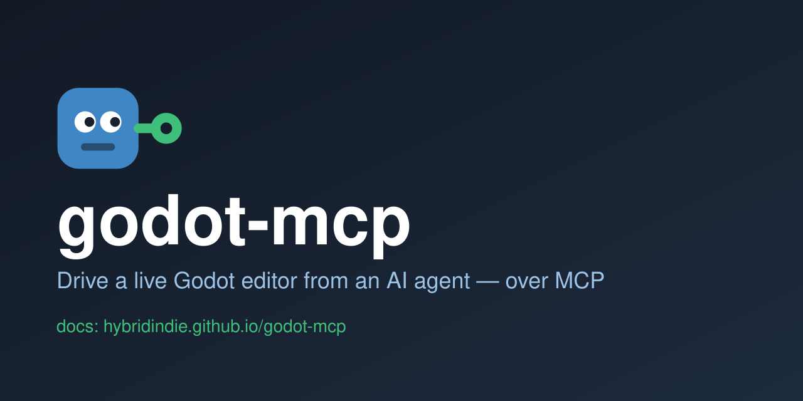

<p align="center">
  <a href="https://hybridindie.github.io/godot-mcp/">
    
  </a>
</p>

<h1 align="center">Godot Editor MCP</h1>

<p align="center">
  A <strong>generic, game-agnostic</strong> <a href="https://modelcontextprotocol.io">Model Context Protocol</a> (MCP) server for <strong>AI-driven Godot development</strong>.
</p>

<p align="center">
  <a href="https://pypi.org/project/godot-editor-mcp/"></a>
  <a href="https://github.com/hybridindie/godot-mcp/pkgs/container/godot-mcp"></a>
  <a href="https://hybridindie.github.io/godot-mcp/"></a>
  <a href="https://github.com/hybridindie/godot-mcp/releases"></a>
  <a href="LICENSE"></a>
</p>

> **📖 The manual is the docs site: [hybridindie.github.io/godot-mcp](https://hybridindie.github.io/godot-mcp/).**
> This README is the front door — what it is, install, quick start, and links. Architecture, guides, and the full tool reference live on the site.
>
> For LLM agents: [`llms.txt`](https://hybridindie.github.io/godot-mcp/llms.txt) (page index) · [`llms-full.txt`](https://hybridindie.github.io/godot-mcp/llms-full.txt) (the whole site as one markdown document).

> **Status:** feature-complete. **198 tools** across **29 categories** — always-on `core` plus 28 toggleable toolsets, of which only `inspection` is enabled by default (the rest are gated off until the agent asks). `godot-editor-mcp` on [PyPI](https://pypi.org/project/godot-editor-mcp/) · `ghcr.io/hybridindie/godot-mcp` · **version `2026.10.21b2`**.

> **One name, three identifiers.** **Godot Editor MCP** is the product: it drives the
> **editor** as its surface, through the addon. The repository and MCP server ID stay
> `godot-mcp` for wire compatibility; the package/CLI is `godot-editor-mcp`; the in-editor
> plugin is **Godot Editor MCP - Addon**; and every tool shares the `godot_` prefix.

---

## What it is

Godot Editor MCP bridges an AI agent and a **live** Godot editor. Instead of editing files blindly on disk, the agent drives the editor directly over MCP:

- **Inspect** the scene tree, selected nodes, and project settings live
- **Mutate** scenes — nodes, scripts, signals — with undo
- **Edit** GDScript and check it for parse errors
- **Run** the game headless or control a live play session
- **Simulate** input, record replays, screenshot, and profile performance
- **Export** builds, analyze code statically, and refactor across scenes

It is **game-agnostic** — it knows Godot, not your game. A tower-defense roguelite, a 3D platformer, and a visual novel use the same generic tools; game-specific vocabulary belongs in a separate consumer project.

```
AI client ──stdio / HTTP──▶ FastMCP server ──WebSocket──▶ Godot addon ──▶ live editor
```

## Prerequisites

| Component | Minimum | Recommended |
|-----------|---------|-------------|
| **Godot** | 4.4 | 4.7 (validated target) |
| **Python** | 3.11 | 3.13 |
| **Package manager** | [uv](https://docs.astral.sh/uv/) | uv |

## Quick start

**1. Install the server**

```bash
pip install godot-editor-mcp      # or run without installing: uvx godot-editor-mcp
```

**2. Install the Godot addon** into your project, then enable it in *Project → Project Settings → Plugins → Godot Editor MCP - Addon*:

```bash
curl -L -o godot_mcp_addon.zip \
  https://github.com/hybridindie/godot-mcp/releases/latest/download/godot_mcp_addon.zip
unzip godot_mcp_addon.zip -d /path/to/your/project/
```

(Or install **Godot Editor MCP - Addon** from the [Godot Asset Store](https://store.godotengine.org/asset/john-d-studios/godot-editor-mcp-addon/).) A status dock appears in the editor; the addon connects out to the server's bridge (`ws://127.0.0.1:9080` by default) and reconnects automatically, so editor and server can start in either order.

**3. Point your MCP client at it** — generate the config, or write the OpenCode entry by hand:

```bash
godot-editor-mcp config --client opencode --write
godot-editor-mcp config --client cursor --project /path/to/project --write
godot-editor-mcp doctor --project /path/to/project   # checklist + a fix for every failure
```

```json
{ "mcp": { "godot": { "type": "local", "command": ["uvx", "godot-editor-mcp"] } } }
```

**4. Ask the agent to work**

- *"Show me the scene tree"* → `godot_inspection_get_scene_tree()`
- *"Enable scene editing, then add a Player node"* → `godot_enable_toolset("scene_edit")`

**5. (Recommended) Install the skills** — paste this into your assistant so it learns how to drive the editor (enable toolsets on its own, read the result verdicts, and avoid the common Godot pitfalls). The server works without them — the instructions and prompts are the fallback — but they make it noticeably better:

```text
Install the Godot Editor MCP AI skills into your skills directory: clone or download
https://github.com/hybridindie/godot-mcp and copy the three folders under its `skills/`
directory (godot-getting-started, godot-playtest-and-debug, godot-expert) into your
skills directory — keep godot-expert/references/ — then reload your skills.
```

More → **[Skills](https://hybridindie.github.io/godot-mcp/reference-skills.html)**.

Docker, HTTP service mode (several clients sharing one editor), and OpenWebUI → **[Configure your client](https://hybridindie.github.io/godot-mcp/getting-started-clients.html)**.

## The gated surface

Only `core` + `inspection` are exposed by default, so the agent's tool list stays sharp. It turns a toolset on with `godot_enable_toolset("scene_edit")`; the server then announces the change (`tools/list_changed`, plus a `subscriptions/listen` stream on the `2026-07-28` protocol) **and** returns the enabled tools' schemas — so the new tools reach the model whether or not its client refreshes. `GODOT_MCP_DEFAULT_TOOLSETS` pre-seeds toolsets at startup. More → **[Toolset gating](https://hybridindie.github.io/godot-mcp/architecture/gating.html)**.

## Documentation

The full manual lives on the docs site:

- **[For creators](https://hybridindie.github.io/godot-mcp/for-creators.html)** — make a game by talking to your AI assistant
- **[For developers](https://hybridindie.github.io/godot-mcp/for-developers.html)** — integrate, extend, or contribute to the server
- **[Get started](https://hybridindie.github.io/godot-mcp/getting-started.html)** — install, connect, and drive your first session
- **[Concepts](https://hybridindie.github.io/godot-mcp/concepts.html)** — how it works and why it's built this way
- **[Guides](https://hybridindie.github.io/godot-mcp/guides.html)** — build a scene, play-test & debug, verify, ship
- **[Reference](https://hybridindie.github.io/godot-mcp/reference.html)** — toolsets, safety, errors, prompts, skills, env vars
- **[Under the hood](https://hybridindie.github.io/godot-mcp/architecture/)** — the bridge, gating, safety, persistence, readiness
- **[Changelog](https://hybridindie.github.io/godot-mcp/changelog.html)** — what shipped in each release

## Development

```bash
uv sync
uv run pytest           # full suite
uv run ruff check .     # lint
uv run mypy             # types
```

The Godot addon lives at `godot/addons/godot_mcp/`; open the `godot/` folder as a project to load it.

## Contributing & license

See [CONTRIBUTING.md](CONTRIBUTING.md). MIT licensed — see [LICENSE](LICENSE).
